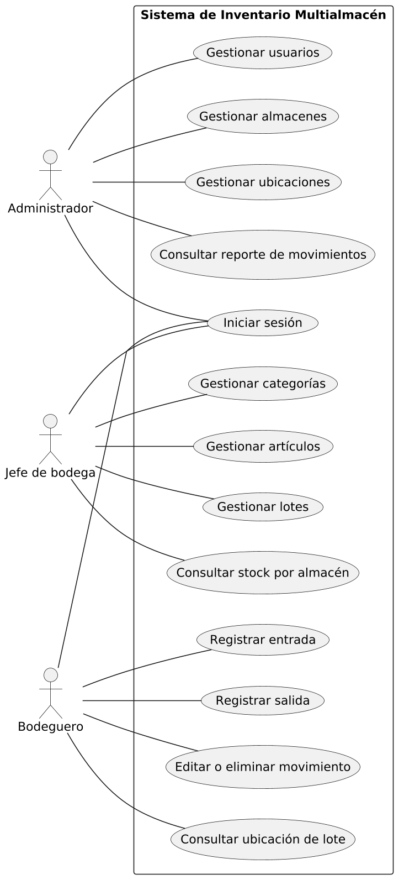
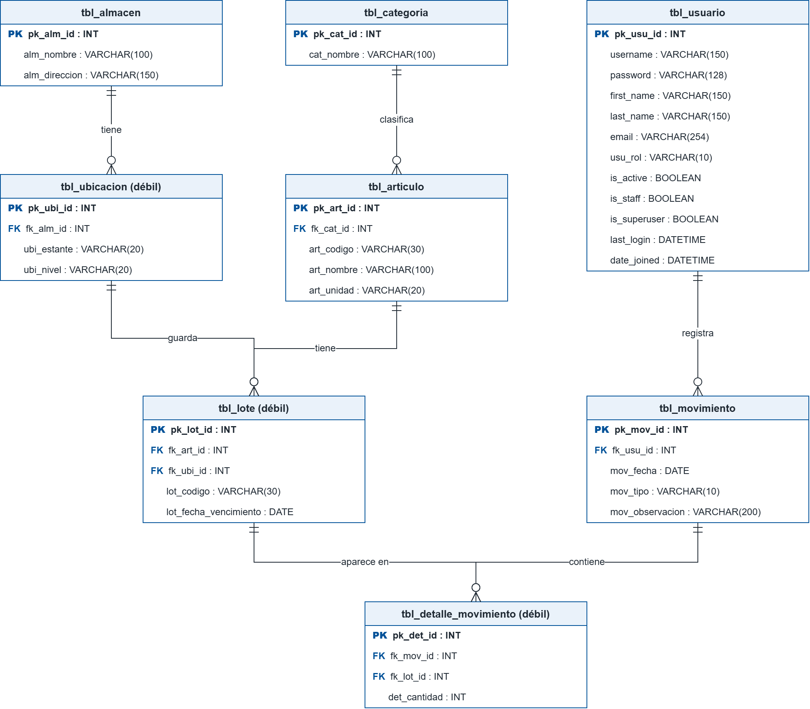

# Sistema de inventario multialmacén (InvenLote)

## Descripción

Proyecto de Programación Avanzada (Uniguajira), Grupo 1.

Es un sistema hecho en Django para llevar el control de los productos que entran y salen de las bodegas de una empresa que tiene varios almacenes. Se guardan los artículos, sus lotes, en qué almacén y estante está cada lote, y cada movimiento de entrada o salida. Se maneja desde una interfaz propia (con Bootstrap 5) que tiene inicio de sesión, un menú según el rol de cada usuario y el CRUD completo de todas las tablas. El panel de administración de Django (`/admin/`) sigue disponible para el administrador.

## Integrantes

- Temistocle Eisyanior Atencio Ipuana – temistocle-Atencio-rgb
- Alain Manuel Suarez Vanegas – alainmanuelsuarezvanegas-dotcom
- Andrés Felipe Ballesteros De Luquez – andresballesterosdeluque

## Tecnologías


El proyecto funciona con estas versiones:

- **Python:** 3.14
- **Django:** 6.1.2
- **Bootstrap:** 5.3.3, cargado por CDN en `templates/base.html` (con los colores de InvenLote en `static/invenlote/app.css`)
- **Base de datos:** SQLite 3 (el archivo `db.sqlite3` ya viene con datos de prueba)

### Librerías del entorno (`requirements.txt`)

- `Django==6.1.2`
- `asgiref==3.12.1` (la instala Django)
- `sqlparse==0.6.0` (la instala Django)
- `tzdata==2026.5` (zonas horarias en Windows)

## Quién usa el sistema

| Actor | Qué hace |
|---|---|
| Administrador | Gestiona usuarios, gestiona almacenes y consulta el reporte de movimientos |
| Jefe de bodega | Gestiona artículos, gestiona lotes y consulta el stock por almacén |
| Bodeguero | Registra entradas, registra salidas y consulta la ubicación de un lote |

## Tablas principales

Cada tabla del diagrama es un modelo y está en su propia app, dentro de la carpeta `apps/`. Los modelos usan la misma convención de nombres del diagrama entidad-relación: tablas con `tbl_`, llave primaria con `pk_`, llaves foráneas con `fk_` y las demás columnas con el prefijo de su tabla.

| Tabla | Modelo (app) | Descripción | Columnas |
| --- | --- | --- | --- |
| `tbl_almacen` | Almacen (almacenes) | Las bodegas de la empresa | `pk_alm_id`, `alm_nombre`, `alm_direccion` |
| `tbl_ubicacion` | Ubicacion (ubicaciones) | Los estantes de cada almacén | `pk_ubi_id`, `fk_alm_id`, `ubi_estante`, `ubi_nivel` |
| `tbl_categoria` | Categoria (categorias) | Para clasificar los artículos | `pk_cat_id`, `cat_nombre` |
| `tbl_articulo` | Articulo (articulos) | Los productos | `pk_art_id`, `fk_cat_id`, `art_codigo`, `art_nombre`, `art_unidad` |
| `tbl_lote` | Lote (lotes) | Los lotes de cada artículo | `pk_lot_id`, `fk_art_id`, `fk_ubi_id`, `lot_codigo`, `lot_fecha_vencimiento` |
| `tbl_movimiento` | Movimiento (movimientos) | Las entradas y salidas | `pk_mov_id`, `mov_fecha`, `mov_tipo`, `mov_observacion`, `fk_usu_id` |
| `tbl_detalle_movimiento` | DetalleMovimiento (detalles_movimiento) | Une cada movimiento con sus lotes y guarda la cantidad | `pk_det_id`, `fk_mov_id`, `fk_lot_id`, `det_cantidad` |
| `tbl_usuario` | Usuario (usuarios) | Los usuarios del sistema. Los tres actores están en esta sola tabla y se distinguen por el rol | `pk_usu_id`, `username`, `password`, `first_name`, `last_name`, `email`, `usu_rol` y los demás campos de usuario de Django |

Relaciones:

- Un almacén tiene muchas ubicaciones.
- Una ubicación guarda muchos lotes.
- Una categoría tiene muchos artículos.
- Un artículo tiene muchos lotes.
- Un usuario registra muchos movimientos (cada movimiento guarda quién lo registró).
- Un movimiento puede tener muchos lotes y un lote puede estar en muchos movimientos. Esto se resuelve con la tabla intermedia `tbl_detalle_movimiento`.

El stock no se guarda en una columna. Se calcula sumando las entradas y restando las salidas de cada lote.

## Diagramas

Están en la carpeta `docs/`.

Casos de uso (`docs/diagrama_actores.png`):



Entidad-relación (`docs/diagrama_er.png`):



## Funcionalidades

Interfaz propia (desde `/`, pide iniciar sesión):

| Pantalla | Ruta | Qué se puede hacer |
|---|---|---|
| Inicio | `/` | Resumen: totales, últimos movimientos y lotes por vencer |
| Movimientos | `/movimientos/` | Lista con filtros (texto, tipo, almacén, fechas), ver detalle, registrar, editar y eliminar |
| Stock por almacén | `/almacenes/stock/` | Stock actual de cada lote, por almacén |
| Almacenes | `/almacenes/` | Crear, listar, buscar, editar y eliminar |
| Ubicaciones | `/ubicaciones/` | Crear, listar, buscar, editar y eliminar |
| Categorías | `/categorias/` | Crear, listar, buscar, editar y eliminar |
| Artículos | `/articulos/` | Crear, listar, buscar, editar y eliminar |
| Lotes | `/lotes/` | Crear, listar, buscar, editar y eliminar (avisa los vencidos y por vencer) |

El CRUD principal es el de **movimientos**: un movimiento (entrada o salida) se guarda junto con todos sus artículos y cantidades en una sola pantalla.

Validaciones y mensajes:

- Una salida no puede ser mayor que el stock del lote.
- No se puede editar ni borrar un movimiento si eso deja un lote con stock negativo (por ejemplo, borrar una entrada de la que ya se sacó mercancía).
- La fecha de un movimiento no puede ser futura y la cantidad debe ser mayor que cero.
- Un movimiento necesita al menos un artículo.
- No se puede eliminar algo que está en uso (por ejemplo, una categoría con artículos): sale un mensaje y no se borra.
- Los errores salen en rojo junto al campo y los avisos de éxito al guardar o eliminar.

## Roles y permisos

Cada usuario tiene un rol, guardado en la columna `usu_rol` de `tbl_usuario` (Administrador, Jefe de bodega o Bodeguero), y solo ve las opciones que puede usar. Si entra a una ruta sin permiso, sale un error 403.

| Rol | Puede crear, editar y eliminar | Solo consulta |
|---|---|---|
| Administrador | Almacenes, ubicaciones y usuarios (por el panel `/admin/`) | Lo demás |
| Jefe de bodega | Categorías, artículos y lotes | Almacenes, ubicaciones y movimientos |
| Bodeguero | Movimientos (con sus detalles) | Lotes, artículos, ubicaciones, almacenes y categorías |

El usuario `admin` además es superusuario (lo necesita para entrar a `/admin/` y gestionar usuarios), así que en la práctica puede hacer todo.

Lo que puede hacer cada rol está definido en `apps/usuarios/permisos.py`. Las vistas lo revisan con `PermissionRequiredMixin` y con el decorador `@permission_required`, y el menú con `{{ perms }}`.

Los usuarios de prueba se crean con `python manage.py crear_usuarios` (también lo hace `cargar_demo`). El administrador puede crear más usuarios y cambiarles el rol desde `/admin/`.

## Panel de administración

- Las 8 tablas están registradas en el admin (incluida `tbl_usuario`), con lista, búsqueda y filtros.
- Las ubicaciones se agregan dentro del formulario del almacén, los lotes dentro del artículo y los detalles dentro del movimiento.
- Cada lote muestra su stock actual y cada artículo su stock total.
- Si una salida es mayor que el stock del lote, el admin muestra un error y no la guarda.

## Cómo ejecutar el proyecto

1. Clonar el repositorio:

```
git clone https://github.com/andresballesterosdeluque/inventario-multialmacen.git
cd inventario-multialmacen
```

2. Crear y activar el entorno virtual (PowerShell):

```
py -m venv venv
venv\Scripts\Activate.ps1
```

3. Instalar las dependencias:

```
python -m pip install -r requirements.txt
```

4. Crear las tablas:

```
python manage.py migrate
```

5. Cargar los datos de prueba (3 por tabla, se puede correr varias veces sin que se repitan):

```
python manage.py cargar_demo
```

6. Iniciar el servidor:

```
python manage.py runserver
```

7. Entrar a http://127.0.0.1:8000/ e iniciar sesión con uno de los usuarios de prueba.

Para correr las pruebas automáticas: `python manage.py test`

## Usuarios de prueba

Todos tienen la contraseña `Inventario2026`.

| Usuario | Rol |
|---|---|
| admin | Administrador y superusuario del admin (`/admin/`) |
| jefe | Jefe de bodega |
| bodeguero | Bodeguero |

Los usuarios están en la tabla `tbl_usuario`, que aparece en el diagrama entidad-relación.

## Carpetas

Todas las apps están dentro de la carpeta `apps/`.

```
inventario-multialmacen/
├── config/                   # settings.py, urls.py, vista de inicio
├── apps/
│   ├── usuarios/             # modelo Usuario (con el rol) y los permisos de cada rol
│   ├── almacenes/            # modelo Almacen, vistas, formularios y rutas
│   ├── ubicaciones/          # modelo Ubicacion (entidad débil de Almacen)
│   ├── categorias/           # modelo Categoria
│   ├── articulos/            # modelo Articulo
│   ├── lotes/                # modelo Lote (entidad débil de Articulo)
│   ├── movimientos/          # modelo Movimiento y el CRUD principal
│   └── detalles_movimiento/  # modelo DetalleMovimiento (tabla intermedia del N:M)
├── templates/                # base.html, inicio, login y las pantallas de cada app
├── static/invenlote/         # CSS de la marca y JavaScript del formulario de movimientos
├── docs/                     # diagramas: diagrama_actores.png y diagrama_er.png
├── db.sqlite3                # base de datos con los datos de prueba
├── manage.py
├── requirements.txt
└── README.md
```
