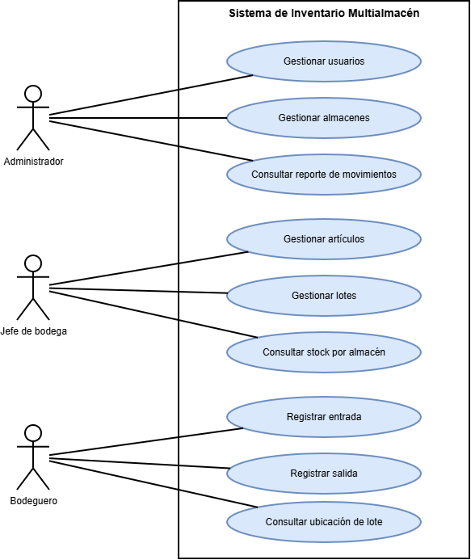
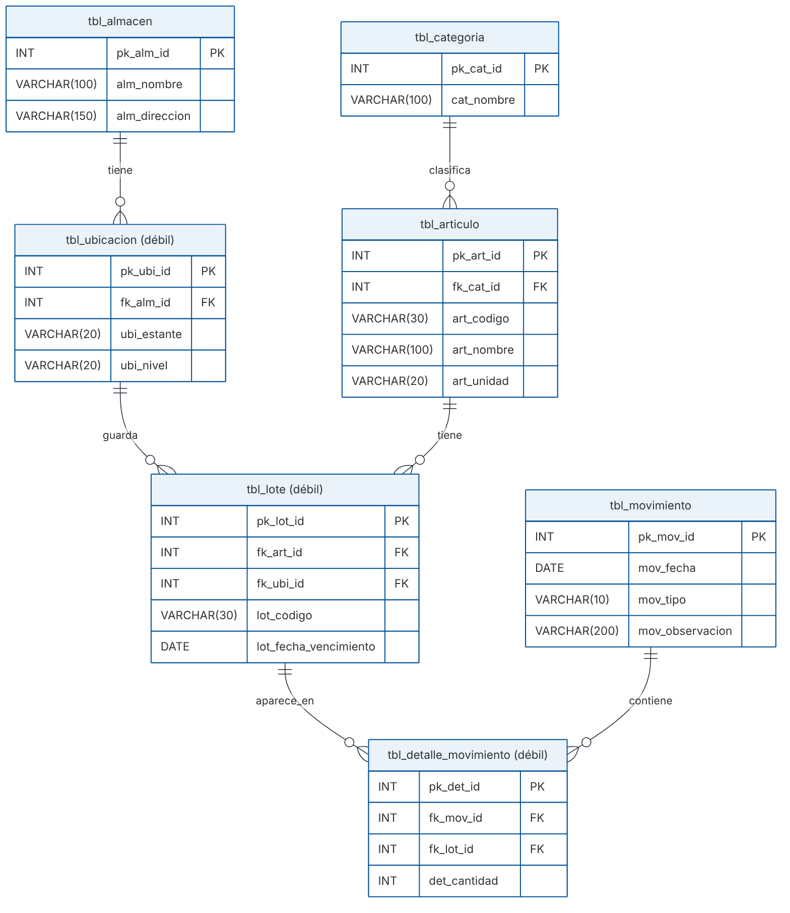

# Sistema de inventario multialmacén

Proyecto de Programación Avanzada (Uniguajira), Grupo 1.

Es un sistema hecho en Django para llevar el control de los productos que entran y salen de las bodegas de una empresa que tiene varios almacenes. Se guardan los artículos, sus lotes, en qué almacén y estante está cada lote, y cada movimiento de entrada o salida. Todo se maneja desde el panel de administración de Django (`/admin/`).

## Integrantes

- Temistocle Eisyanior Atencio Ipuana
- Alain Manuel Suarez Vanegas
- Andrés Felipe Ballesteros De Luquez

## Qué usamos

- Python 3.14
- Django 6.1.2
- SQLite (el archivo `db.sqlite3` ya viene con datos de prueba)

## Quién usa el sistema

| Actor | Qué hace |
|---|---|
| Administrador | Gestiona usuarios, gestiona almacenes y consulta el reporte de movimientos |
| Jefe de bodega | Gestiona artículos, gestiona lotes y consulta el stock por almacén |
| Bodeguero | Registra entradas, registra salidas y consulta la ubicación de un lote |

## Las tablas

Cada tabla del diagrama es un modelo y está en su propia app:

| App | Modelo | Para qué sirve |
|---|---|---|
| almacenes | Almacen | Las bodegas de la empresa |
| ubicaciones | Ubicacion | Los estantes de cada almacén |
| categorias | Categoria | Para clasificar los artículos |
| articulos | Articulo | Los productos |
| lotes | Lote | Los lotes de cada artículo |
| movimientos | Movimiento | Las entradas y salidas |
| detalles_movimiento | DetalleMovimiento | Une cada movimiento con sus lotes y guarda la cantidad |

Relaciones:

- Un almacén tiene muchas ubicaciones.
- Una ubicación guarda muchos lotes.
- Una categoría tiene muchos artículos.
- Un artículo tiene muchos lotes.
- Un movimiento puede tener muchos lotes y un lote puede estar en muchos movimientos. Esto se resuelve con la tabla DetalleMovimiento.

El stock no se guarda en una columna. Se calcula sumando las entradas y restando las salidas de cada lote.

## Panel de administración

- Las 7 tablas están registradas en el admin, con lista, búsqueda y filtros.
- Las ubicaciones se agregan dentro del formulario del almacén.
- Los lotes se agregan dentro del formulario del artículo.
- Los detalles (lote y cantidad) se agregan dentro del formulario del movimiento.
- Cada lote muestra su stock actual y cada artículo su stock total.
- Si una salida es mayor que el stock del lote, el admin muestra un error y no la guarda.

## Cómo ejecutarlo

1. Clonar el repositorio:

```
git clone https://github.com/andresballesterosdeluque/inventario-multialmacen.git
cd inventario-multialmacen
```

2. Crear y activar el entorno virtual (PowerShell):

```
py -m venv venv
venv\Scripts\Activate.ps1
```

3. Instalar las dependencias:

```
python -m pip install -r requirements.txt
```

4. Crear las tablas:

```
python manage.py migrate
```

5. Cargar los datos de prueba (3 por tabla, se puede correr varias veces sin que se repitan):

```
python manage.py cargar_demo
```

6. Iniciar el servidor:

```
python manage.py runserver
```

7. Entrar a http://127.0.0.1:8000/admin/

## Usuario del administrador

- Usuario: admin
- Contraseña: Inventario2026

## Diagramas

Están en la carpeta `docs/`.

Casos de uso (`docs/diagrama_actores.png`):



Entidad-relación (`docs/diagrama_er.png`):



## Carpetas

```
inventario-multialmacen/
├── config/               # settings.py, urls.py
├── almacenes/            # modelo Almacen
├── ubicaciones/          # modelo Ubicacion (entidad débil de Almacen)
├── categorias/           # modelo Categoria
├── articulos/            # modelo Articulo
├── lotes/                # modelo Lote (entidad débil de Articulo)
├── movimientos/          # modelo Movimiento
├── detalles_movimiento/  # modelo DetalleMovimiento (tabla intermedia del N:M)
├── docs/                 # diagramas: diagrama_actores.png y diagrama_er.png
├── db.sqlite3            # base de datos con los datos de prueba
├── manage.py
├── requirements.txt
└── README.md
```
