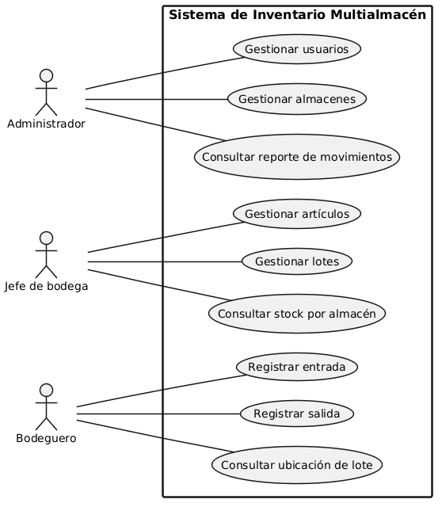
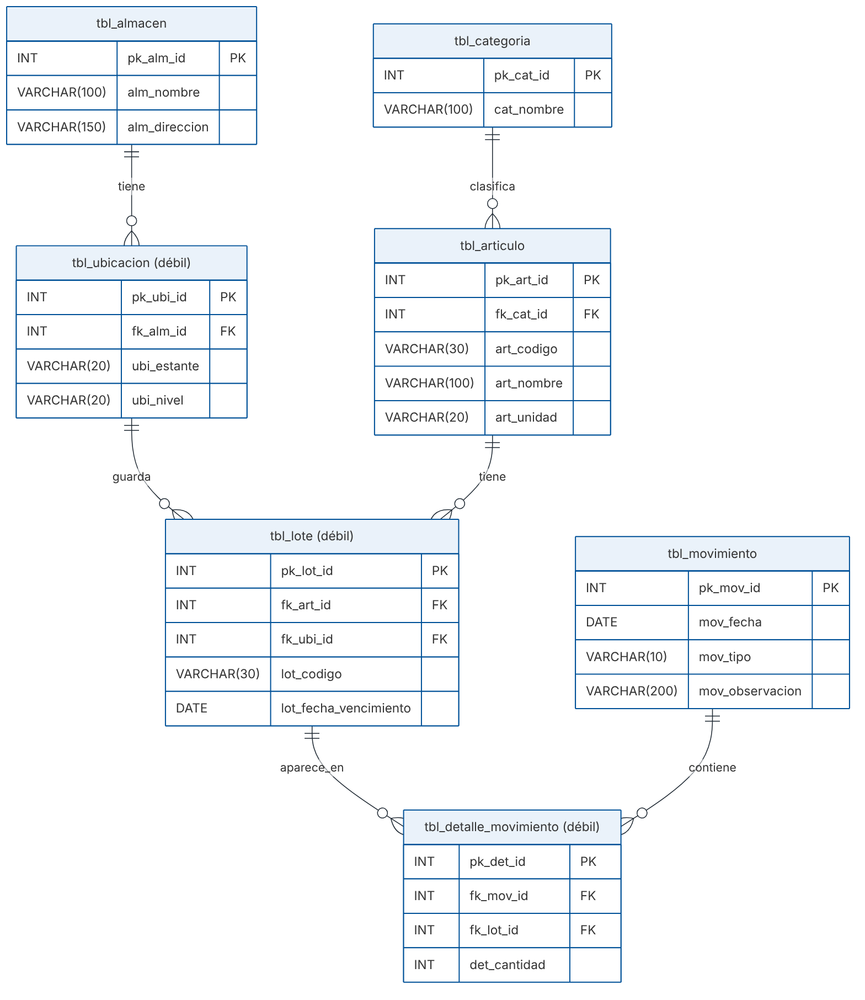

# Nombre del sistema

InvenLote · Sistema de inventario multialmacén

## Descripción

Proyecto de Programación Avanzada (Uniguajira), Grupo 1.

Es un sistema hecho en Django para llevar el control de los productos que entran y salen de las bodegas de una empresa que tiene varios almacenes. Se guardan los artículos, sus lotes, en qué almacén y estante está cada lote, y cada movimiento de entrada o salida. Se maneja desde una interfaz propia (con Bootstrap 5) que tiene inicio de sesión, un menú según el rol de cada usuario y el CRUD completo de todas las tablas. El panel de administración de Django (`/admin/`) sigue disponible para el administrador.

## Integrantes

- Temistocle Eisyanior Atencio Ipuana – temistocle-Atencio-rgb
- Alain Manuel Suarez Vanegas – (usuario de GitHub por completar)
- Andrés Felipe Ballesteros De Luquez – andresballesterosdeluque

## Tecnologías

- Python 3.14
- Django 6.1.2
- Bootstrap 5.3.3, cargado por CDN en `templates/base.html` (con los colores de InvenLote en `static/invenlote/app.css`)
- SQLite (el archivo `db.sqlite3` ya viene con datos de prueba)

## Quién usa el sistema

| Actor | Qué hace |
|---|---|
| Administrador | Gestiona usuarios, gestiona almacenes y consulta el reporte de movimientos |
| Jefe de bodega | Gestiona artículos, gestiona lotes y consulta el stock por almacén |
| Bodeguero | Registra entradas, registra salidas y consulta la ubicación de un lote |

## Tablas principales

Cada tabla del diagrama es un modelo y está en su propia app:

| App | Modelo | Para qué sirve |
|---|---|---|
| almacenes | Almacen | Las bodegas de la empresa |
| ubicaciones | Ubicacion | Los estantes de cada almacén |
| categorias | Categoria | Para clasificar los artículos |
| articulos | Articulo | Los productos |
| lotes | Lote | Los lotes de cada artículo |
| movimientos | Movimiento | Las entradas y salidas |
| detalles_movimiento | DetalleMovimiento | Une cada movimiento con sus lotes y guarda la cantidad |

Relaciones:

- Un almacén tiene muchas ubicaciones.
- Una ubicación guarda muchos lotes.
- Una categoría tiene muchos artículos.
- Un artículo tiene muchos lotes.
- Un movimiento puede tener muchos lotes y un lote puede estar en muchos movimientos. Esto se resuelve con la tabla DetalleMovimiento.

El stock no se guarda en una columna. Se calcula sumando las entradas y restando las salidas de cada lote.

## Funcionalidades

Interfaz propia (desde `/`, pide iniciar sesión):

| Pantalla | Ruta | Qué se puede hacer |
|---|---|---|
| Inicio | `/` | Resumen: totales, últimos movimientos y lotes por vencer |
| Movimientos | `/movimientos/` | Lista con filtros (texto, tipo, almacén, fechas), ver detalle, registrar, editar y eliminar |
| Stock por almacén | `/almacenes/stock/` | Stock actual de cada lote, por almacén |
| Almacenes | `/almacenes/` | Crear, listar, buscar, editar y eliminar |
| Ubicaciones | `/ubicaciones/` | Crear, listar, buscar, editar y eliminar |
| Categorías | `/categorias/` | Crear, listar, buscar, editar y eliminar |
| Artículos | `/articulos/` | Crear, listar, buscar, editar y eliminar |
| Lotes | `/lotes/` | Crear, listar, buscar, editar y eliminar (avisa los vencidos y por vencer) |

El CRUD principal es el de **movimientos**: un movimiento (entrada o salida) se guarda junto con todos sus artículos y cantidades en una sola pantalla.

Validaciones y mensajes:

- Una salida no puede ser mayor que el stock del lote.
- No se puede editar ni borrar un movimiento si eso deja un lote con stock negativo (por ejemplo, borrar una entrada de la que ya se sacó mercancía).
- La fecha de un movimiento no puede ser futura y la cantidad debe ser mayor que cero.
- Un movimiento necesita al menos un artículo.
- No se puede eliminar algo que está en uso (por ejemplo, una categoría con artículos): sale un mensaje y no se borra.
- Los errores salen en rojo junto al campo y los avisos de éxito al guardar o eliminar.

## Roles y permisos

Cada usuario tiene un rol (grupo de Django) y solo ve las opciones que puede usar. Si entra a una ruta sin permiso, sale un error 403.

| Rol | Puede crear, editar y eliminar | Solo consulta |
|---|---|---|
| Administrador | Almacenes, ubicaciones y usuarios (por el panel `/admin/`) | Lo demás |
| Jefe de bodega | Categorías, artículos y lotes | Almacenes, ubicaciones y movimientos |
| Bodeguero | Movimientos (con sus detalles) | Lotes, artículos, ubicaciones, almacenes y categorías |

Los roles se crean con `python manage.py crear_roles` (también lo hace `cargar_demo`).

## Panel de administración

- Las 7 tablas están registradas en el admin, con lista, búsqueda y filtros.
- Las ubicaciones se agregan dentro del formulario del almacén, los lotes dentro del artículo y los detalles dentro del movimiento.
- Cada lote muestra su stock actual y cada artículo su stock total.
- Si una salida es mayor que el stock del lote, el admin muestra un error y no la guarda.

## Cómo ejecutarlo

1. Clonar el repositorio:

```
git clone https://github.com/andresballesterosdeluque/inventario-multialmacen.git
cd inventario-multialmacen
```

2. Crear y activar el entorno virtual (PowerShell):

```
py -m venv venv
venv\Scripts\Activate.ps1
```

3. Instalar las dependencias:

```
python -m pip install -r requirements.txt
```

4. Crear las tablas:

```
python manage.py migrate
```

5. Cargar los datos de prueba (3 por tabla, se puede correr varias veces sin que se repitan):

```
python manage.py cargar_demo
```

6. Iniciar el servidor:

```
python manage.py runserver
```

7. Entrar a http://127.0.0.1:8000/ e iniciar sesión con uno de los usuarios de prueba.

Para correr las pruebas automáticas: `python manage.py test`

## Usuarios de prueba

Todos tienen la contraseña `Inventario2026`.

| Usuario | Rol |
|---|---|
| admin | Administrador (también entra a `/admin/`) |
| jefe | Jefe de bodega |
| bodeguero | Bodeguero |

La base de datos (`auth_user`, `auth_group`) guarda los usuarios y roles de Django; no forman parte del diagrama entidad-relación del negocio, que no cambió.

## Diagramas

Están en la carpeta `docs/`.

Casos de uso (`docs/diagrama_actores.png`):



Entidad-relación (`docs/diagrama_er.png`):



## Carpetas

```
inventario-multialmacen/
├── config/               # settings.py, urls.py
├── almacenes/            # modelo Almacen, vistas, formularios y rutas
├── ubicaciones/          # modelo Ubicacion (entidad débil de Almacen)
├── categorias/           # modelo Categoria
├── articulos/            # modelo Articulo
├── lotes/                # modelo Lote (entidad débil de Articulo)
├── movimientos/          # modelo Movimiento
├── detalles_movimiento/  # modelo DetalleMovimiento (tabla intermedia del N:M)
├── docs/                 # diagramas: diagrama_actores.png y diagrama_er.png
├── templates/            # base.html, inicio, login y las pantallas de cada app
├── static/invenlote/     # CSS de la marca y JavaScript del formulario de movimientos
├── db.sqlite3            # base de datos con los datos de prueba
├── manage.py
├── requirements.txt
└── README.md
```
